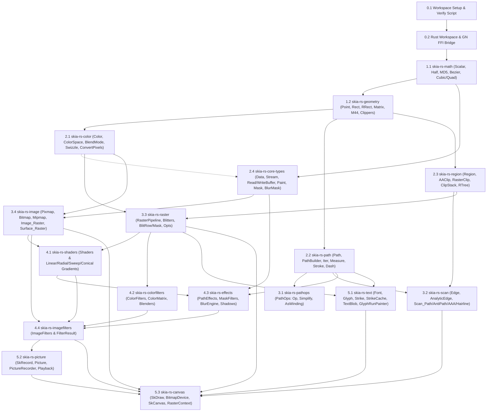

# Skia Rust Rewrite — Porting Plan & Status

This document tracks the dependency graph, module porting order, architecture, and live verification status for rewriting Skia (everything except `third_party/`) in safe Rust behind Skia's unchanged C++ API in `include/`.

---

## Baseline & Verification Status

| Phase | Target | Baseline Coverage | Status |
|---|---|---|---|
| **Phase 1** | CPU raster backend (`config 8888`) | Covered: `skia-baseline/out/dm/dm.json` (`1000` `8888` GM MD5 hashes) + `2644` CPU unit tests via `dm --src gm tests --nogpu --config 8888` | **Layer 1 (in progress: 3/19 modules)** |
| **Phase 2** | Image codecs (`src/codec/`, `src/encode/`) | Needs baseline check (`--src image colorImage` + codec unit tests) before starting | Pending |
| **Phase 3** | SkSL shader compiler (`src/sksl/`) | Covered by CPU SkSL unit tests + GMs (`--src gm tests --nogpu --config 8888`) | Pending |
| **Phase 4** | GPU backends (Ganesh, then Graphite) | **Not yet covered** (`skia_use_gl = false`; needs GPU baseline before starting) | Pending |
| **Phase 5** | PDF, SVG, XML, and `modules/` | Needs PDF/SVG/module baseline verification before starting | Pending |

### Reference Baseline Details (from `UPSTREAM.toml` & `BASELINE.toml`)
- **Pinned Skia commit:** `67badb88843a848541ffb57fb0e7a3fc88c48051` (`main`, `2026-11-25`)
- **Baseline GN args:** `is_debug = false skia_use_fontconfig = false skia_use_system_freetype2 = false skia_use_gl = false`
- **Baseline DM flags:** `--src gm tests --nogpu --config 8888 --writePath out/dm`
- **Baseline Machine:** `x86_64, Linux, avx2` (20 cores, 15 GiB RAM)

---

## Architecture & Ground Rules

1. **Unchanged Public C++ API & Protected Paths**
   - `skia-baseline/` (renamed from `baseline/` in commit `88e8216d2ccddd50727971ac52939d5dc4feaf75`) is the untouched reference Skia checkout + reference `dm.json` (`skia-baseline/out/dm/dm.json`) and is **read-only forever**: never write anything into `skia-baseline/` (no build outputs, no scripts, no temp files).
   - `skia-rewrite/` is the working Skia copy, with external dependencies (`third_party/externals`, `buildtools`, `bin/gn`, `third_party/gn`, `third_party/ninja`) symlinked read-only to `skia-baseline/`.
   - All Rust builds live inside `skia-rewrite/out/Rust/` (and per-worktree `skia-rewrite/out/rust-<module>/`), completely separate from `skia-baseline/out/Original/`.
   - Protected invariants enforced before every commit to `main` (and by `tools/verify_dm/`):
     1. `skia-baseline/` never changes after `88e8216d2ccddd50727971ac52939d5dc4feaf75`:
        ```bash
        git diff --quiet 88e8216d2ccddd50727971ac52939d5dc4feaf75 -- skia-baseline
        git status --porcelain -- skia-baseline  # must be empty
        ```
     2. `skia-rewrite/{gm,tests,dm,bench,include}` must stay byte-for-byte identical to `skia-baseline/{gm,tests,dm,bench,include}`.
2. **Safe Rust + Minimal FFI Boundary**
   - The Rust toolchain is pinned in `rust-toolchain.toml` (`1.100.0`).
   - All Rust implementation crates live in a Cargo workspace under `skia-rewrite/rust/crates/*` and carry `#![forbid(unsafe_code)]`.
   - `unsafe` is permitted **only** at the C++/Rust FFI boundary in `skia-rewrite/rust/crates/skia-rs-ffi` (compiled as a single `staticlib` `libskia_rs_ffi.a` via `skia-rewrite/gn/build_rust_skia.py`) and thin C++ adapter shims in `skia-rewrite/src/rust_bridge/`.
3. **Per-Module GN Build Flags**
   - `skia-rewrite/gn/skia_rust.gni` defines one boolean flag per module (e.g. `skia_rust_md5`, `skia_rust_math`, `skia_rust_geometry`, `skia_rust_path`, `skia_rust_region`, etc.) plus a convenience umbrella flag `skia_rust_phase1`.
   - When `skia_rust_<module> = false`, GN compiles Skia's original C++ `.cpp` file(s).
   - When `skia_rust_<module> = true`, GN swaps in `skia-rewrite/src/rust_bridge/<module>_rust.cpp` and links `libskia_rs_ffi.a`. Original and Rust builds coexist side by side.
4. **Parallel Fan-Out & Shared File Ownership**
   - **Layer 0 & Layer 1 (Foundations):** Single agent to establish the bridge, verification script, and core math/geometry types cleanly.
   - **Layers 2–5:** Up to **4 agents in parallel**, each in its own `git worktree`, branch (`port/<module>`), and build directory (`skia-rewrite/out/rust-<module>`), with `-j 5` per worker across 20 cores.
   - **Shared file owner:** The coordinator / designated bridge owner manages edits to existing lines in `skia-rewrite/BUILD.gn`, `skia-rewrite/gn/skia_rust.gni`, `skia-rewrite/rust/Cargo.toml`, and `skia-rewrite/rust/crates/skia-rs-ffi/src/lib.rs`. Module agents add self-contained crates (`skia-rewrite/rust/crates/skia-rs-<mod>/`), FFI submodules (`skia-rewrite/rust/crates/skia-rs-ffi/src/<mod>.rs`), and bridge shims (`skia-rewrite/src/rust_bridge/<mod>_rust.cpp`).
   - **Merge & Verify:** Merge one module at a time into `main`, run `cargo run --release --manifest-path tools/verify_dm/Cargo.toml` (`--src gm tests --nogpu --config 8888`, comparing all `1000/1000` `dm.json` hashes against `skia-baseline/out/dm/dm.json` and checking protected paths), update **both `PORTING.md` and the `README.md` Progress section/bar** in the same commit, commit with `<module>: <what changed> (DM: X/Y match)`, push `main`, and delete the merged branch and worktree.

---

## Phase 1: CPU Raster Backend (`config 8888`) — Dependency Graph



---

## Phase 1: Proposed Module Porting Order & Status Tracker

### Layer 0 — Foundations & Infrastructure (Single Agent)
| # | Module / Crate | GN Flag | Key Skia Files Covered | Depends On | Parallel Group | Status |
|---|---|---|---|---|---|---|
| 0.1 | `workspace-setup` | — | `skia-baseline/` rename + `skia-rewrite/` working copy + `tools/verify_dm/` (safe Rust) + `rust-toolchain.toml` (`1.100.0`) | — | Solo | **Done** |
| 0.2 | `rust-bridge` | `skia_rust_md5` | `skia-rewrite/rust/Cargo.toml`, `crates/skia-rs-ffi`, `gn/skia_rust.gni`, `BUILD.gn` `skia_rs_ffi`, `SkMD5` bridge smoke test | 0.1 | Solo | **Done** |

### Layer 1 — Core Math & Geometry (Single Agent)
| # | Module / Crate | GN Flag | Key Skia Files Covered | Depends On | Parallel Group | Status |
|---|---|---|---|---|---|---|
| 1.1 | `skia-rs-math` | `skia_rust_math` | `SkScalar`, `SkFloatingPoint`, `SkHalf`, `SkSafeMath`, `SkMathPriv`, `SkMD5`, `SkChecksum`, `SkBase64`, `SkCubicMap`, `SkQuads`, `SkCubics`, `SkBezierCurves`, `SkUTF`, `SkFloatToDecimal` | 0.2 | Solo | **Done** (`DM: 1000/1000`) |
| 1.2 | `skia-rs-geometry` | `skia_rust_geometry` | `SkPoint`, `SkPoint3`, `SkRect`, `SkRRect`, `SkRSXform`, `SkMatrix`, `SkMatrixInvert`, `SkM44`, `SkMatrix22`, `SkGeometry`, `SkLineClipper`, `SkQuadClipper`, `SkCubicClipper`, `SkEdgeClipper`, `SkVertices`, `SkVertState` | 1.1 | Solo | **In progress** (10/16 files, `DM: 1000/1000`) |

### Layer 2 — Core Primitives & Data Structures (Fan Out: 4 Agents)
| # | Module / Crate | GN Flag | Key Skia Files Covered | Depends On | Parallel Group | Status |
|---|---|---|---|---|---|---|
| 2.1 | `skia-rs-color` | `skia_rust_color` | `SkColor`, `SkColorSpace`, `SkColorSpaceXformSteps`, `SkColorTable`, `SkUnPreMultiply`, `SkImageInfo`, `SkBlendMode`, `SkBlendModeBlender`, `SkSwizzle`, `SkSwizzler_opts`, `SkConvertPixels`, `SkYUVMath`, `SkYUVAInfo`, `SkYUVAPixmaps`, `SkMasks` | 1.1, 1.2 | Wave A (4-way) | Planned |
| 2.2 | `skia-rs-path` | `skia_rust_path` | `SkPath`, `SkPathBuilder`, `SkPathData`, `SkPathIter`, `SkPathRaw`, `SkPathRawShapes`, `SkPathPriv`, `SkPathMeasure`, `SkContourMeasure`, `SkPathUtils`, `SkPath_interpolate`, `SkPath_serial`, `SkStroke`, `SkStrokeRec`, `SkStrokerPriv`, `SkDashPath`, `SkParsePath` | 1.1, 1.2 | Wave A (4-way) | Planned |
| 2.3 | `skia-rs-region` | `skia_rust_region` | `SkRegion`, `SkRegion_path`, `SkAAClip`, `SkRasterClip`, `SkClipStack`, `SkClipStackUtils`, `SkRTree`, `SkBBHFactory` | 1.2 | Wave A (4-way) | Planned |
| 2.4 | `skia-rs-core-types` | `skia_rust_core_types` | `SkData`, `SkDataTable`, `SkStream`, `SkBuffer`, `SkReadBuffer`, `SkWriteBuffer`, `SkWriter32`, `SkString`, `SkFlattenable`, `SkPaint`, `SkPaintPriv`, `SkDescriptor`, `SkMask`, `SkBlurMask`, `SkGaussFilter`, `SkMaskGamma`, `SkMaskCache` | 1.1 | Wave A (4-way) | Planned |

### Layer 3 — Rasterization Core, PathOps & Pixel Surfaces (Fan Out: 4 Agents)
| # | Module / Crate | GN Flag | Key Skia Files Covered | Depends On | Parallel Group | Status |
|---|---|---|---|---|---|---|
| 3.1 | `skia-rs-pathops` | `skia_rust_pathops` | All of `src/pathops/*` (`Op`, `Simplify`, `AsWinding`, `TightBounds`, `SkOpBuilder`) | 1.2, 2.2 | Wave B (4-way) | Planned |
| 3.2 | `skia-rs-scan` | `skia_rust_scan` | `SkEdge`, `SkAnalyticEdge`, `SkEdgeBuilder`, `SkAlphaRuns`, `SkScan`, `SkScan_Path`, `SkScan_AntiPath`, `SkScan_AAAPath`, `SkScan_Hairline`, `SkScan_Antihair`, `SkDistanceFieldGen` | 1.2, 2.2, 2.3 | Wave B (4-way) | Planned |
| 3.3 | `skia-rs-raster` | `skia_rust_raster` | `SkRasterPipeline`, `SkRasterPipelineBlitter`, `SkRasterPipeline_opts`, `SkBlitter`, `SkBlitter_ARGB32`, `SkBlitter_A8`, `SkBlitter_Sprite`, `SkSpriteBlitter_ARGB32`, `SkBlitRow_D32`, `SkBlitRow_opts`, `SkBlitMask_opts`, `SkMemset_opts`, `SkOpts` | 1.2, 2.1, 2.3 | Wave B (4-way) | Planned |
| 3.4 | `skia-rs-image` | `skia_rust_image` | `SkPixmap`, `SkPixmapDraw`, `SkPixelRef`, `SkMallocPixelRef`, `SkBitmap`, `SkBitmapCache`, `SkBitmapProcState`, `SkMipmap*`, `SkImage`, `SkImage_Base`, `SkImage_Raster`, `SkImage_Lazy`, `SkImage_Picture`, `SkRescaleAndReadPixels`, `SkSurface`, `SkSurface_Base`, `SkSurface_Raster`, `SkSurface_Null`, `SkSpecialImage` | 1.2, 2.1, 2.4 | Wave B (4-way) | Planned |

### Layer 4 — Shaders, Color Filters, Path/Mask Effects & Image Filters (Fan Out: 3–4 Agents)
| # | Module / Crate | GN Flag | Key Skia Files Covered | Depends On | Parallel Group | Status |
|---|---|---|---|---|---|---|
| 4.1 | `skia-rs-shaders` | `skia_rust_shaders` | `SkShader`, `SkShaderBase`, `SkColorShader`, `SkEmptyShader`, `SkBlendShader`, `SkColorFilterShader`, `SkCoordClampShader`, `SkLocalMatrixShader`, `SkTransformShader`, `SkTriColorShader`, `SkWorkingColorSpaceShader`, `SkImageShader`, `SkBitmapProcShader`, `SkPictureShader`, `SkPerlinNoiseShaderImpl`, `SkGainmapShader`, `src/shaders/gradients/*` | 2.1, 3.3, 3.4 | Wave C (3-way) | Planned |
| 4.2 | `skia-rs-colorfilters` | `skia_rust_colorfilters` | `SkColorFilter`, `src/effects/colorfilters/*` (except `SkRuntimeColorFilter` → Phase 3), `SkColorMatrix`, `SkColorMatrixFilter`, `SkHighContrastFilter`, `SkBlenders` | 2.1, 3.3 | Wave C (3-way) | Planned |
| 4.3 | `skia-rs-effects` | `skia_rust_effects` | `SkPathEffect`, `Sk1DPathEffect`, `Sk2DPathEffect`, `SkCornerPathEffect`, `SkDashPathEffect`, `SkDiscretePathEffect`, `SkTrimPathEffect`, `SkMaskFilter`, `SkBlurMaskFilterImpl`, `SkMaskBlurFilter`, `SkBlurEngine`, `SkEmbossMask*`, `SkShaderMaskFilterImpl`, `SkTableMaskFilter`, `SkDrawShadowInfo`, `SkShadowTessellator`, `SkShadowUtils` | 2.2, 2.4, 4.1 | Wave C / D | Planned |
| 4.4 | `skia-rs-imagefilters` | `skia_rust_imagefilters` | `SkImageFilter`, `SkImageFilterTypes`, `SkImageFilterCache`, `SkLocalMatrixImageFilter`, `src/effects/imagefilters/*` (except `SkRuntimeImageFilter` → Phase 3) | 3.4, 4.1, 4.2, 4.3 | Wave D | Planned |

### Layer 5 — Text, Picture Recording & Canvas (Fan Out: 2 Agents, then Converge)
| # | Module / Crate | GN Flag | Key Skia Files Covered | Depends On | Parallel Group | Status |
|---|---|---|---|---|---|---|
| 5.1 | `skia-rs-text` | `skia_rust_text` | `SkFont`, `SkFontMetricsPriv`, `SkFontDescriptor`, `SkFontMgr`, `SkTypeface`, `SkTypefaceCache`, `SkGlyph`, `SkScalerContext`, `SkStrike`, `SkStrikeCache`, `SkStrikeSpec`, `SkTextBlob`, `GlyphRun`, `SkGlyphRunPainter`, `SkTextUtils` (font parsing via Rust crates such as `skrifa`/`read-fonts` where appropriate) | 1.2, 2.2, 2.4, 3.3 | Wave D (parallel w/ 4.4) | Planned |
| 5.2 | `skia-rs-picture` | `skia_rust_picture` | `SkRecord`, `SkRecords`, `SkRecordCanvas`, `SkRecordDraw`, `SkRecordOpts`, `SkPicture`, `SkPictureRecorder`, `SkPictureRecord`, `SkPicturePlayback`, `SkPictureData`, `SkPictureFlat`, `SkDrawable`, `SkRecordedDrawable`, `SkAnnotation`, `SkLatticeIter`, `SkMultiPictureDocument` | 2.2, 2.4, 4.1, 4.3, 4.4 | Wave E | Planned |
| 5.3 | `skia-rs-canvas` | `skia_rust_canvas` | `SkDraw`, `SkDraw_atlas`, `SkDraw_text`, `SkDraw_vertices`, `SkDevice`, `SkBitmapDevice`, `SkClipStackDevice`, `SkCanvas`, `SkCanvas_Raster`, `SkCanvasPriv`, `SkOverdrawCanvas`, `SkNWayCanvas`, `SkNoDrawCanvas`, `SkNullCanvas`, `SkPaintFilterCanvas`, `SkCanvasStack`, `SkRecorder`, `RasterContext`, `src/cpu/Recorder` | 3.2, 3.3, 3.4, 4.4, 5.1, 5.2 | Final (Solo) | Planned |

---

## Sub-Module Granularity Note

Large modules (such as `skia-rs-geometry`, `skia-rs-path`, `skia-rs-raster`, `skia-rs-shaders`, and `skia-rs-canvas`) will be merged in **incremental, independently verified commits** (e.g. `SkMatrix`, `SkRect`, `SkRRect` individually; `SkPathIter`, `SkPathBuilder`, `SkStroke` individually) so every commit on `main` is small, reviewable, and verified against the full `1000/1000` DM `8888` baseline + `2644/2644` CPU unit tests.

---

## Upcoming Phases (High-Level Roadmap)

- **Phase 2 — Image Codecs (`src/codec/`, `src/encode/`):** Replace libpng/libjpeg/libwebp/wuffs/dng glue with Rust crates (`png`, `zune-jpeg`, `image-webp`, `gif`, etc.) behind `SkCodec` / `SkEncoder`. Requires verifying baseline coverage for `--src image colorImage` before starting.
- **Phase 3 — SkSL (`src/sksl/`, `SkRuntimeEffect`):** Safe Rust lexer, parser, IR, typechecker, optimizer, and RP/GLSL/WGSL/SPIR-V/Metal backends.
- **Phase 4 — GPU Backends (Ganesh, then Graphite):** Requires establishing a GPU baseline (`gl`/`vk`) before starting.
- **Phase 5 — PDF, SVG, XML & `modules/`:** `src/pdf/`, `src/svg/`, `src/xml/`, `modules/skunicode`, `modules/skshaper`, `modules/skparagraph`, `modules/skottie`, `modules/sksg`, `modules/bentleyottmann`, etc.
