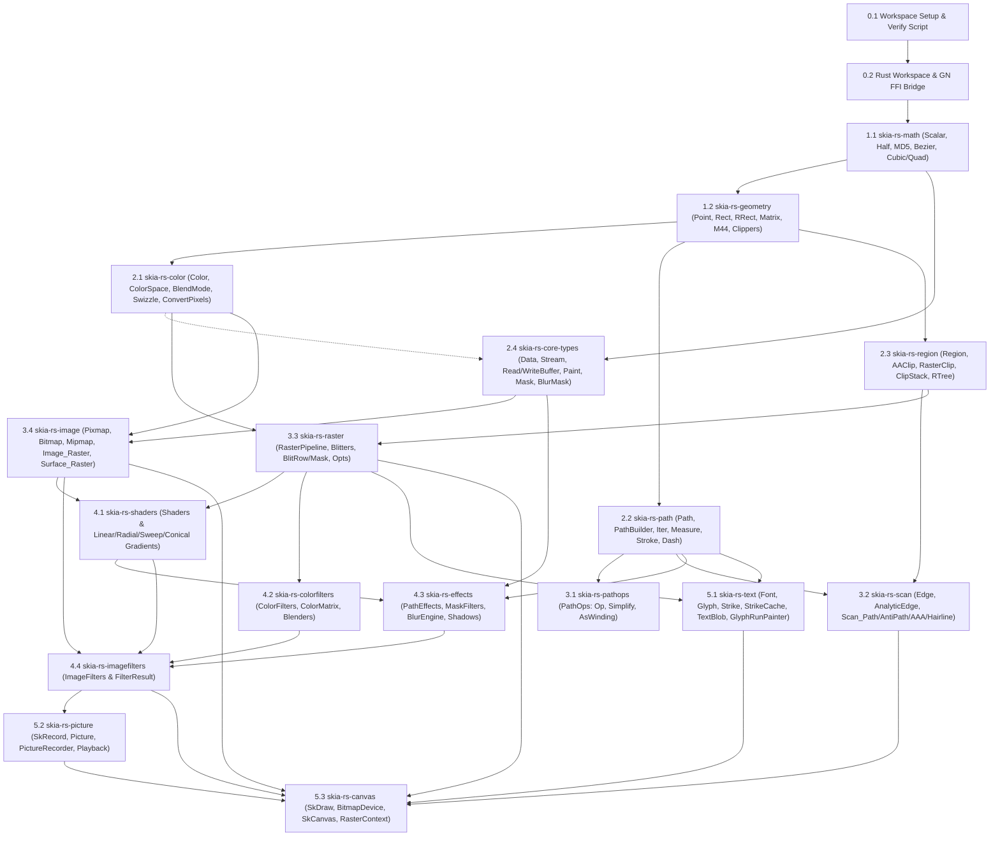
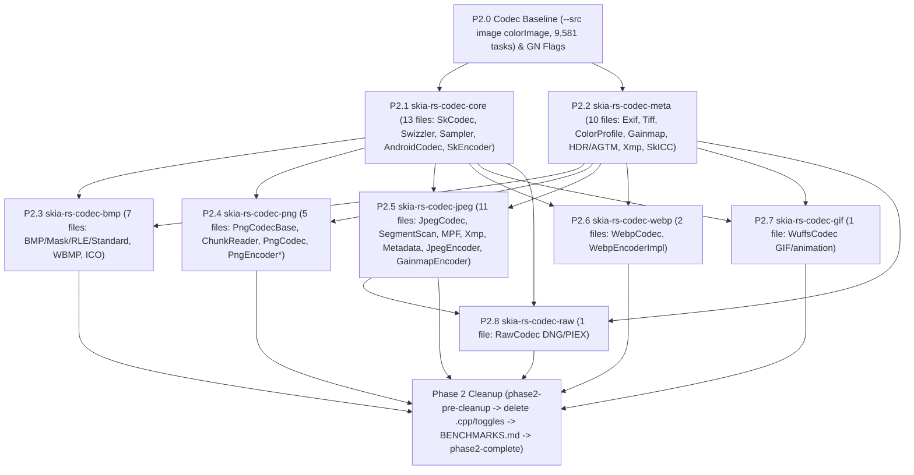

# Skia Rust Rewrite — Porting Plan & Status

This document tracks the dependency graph, module porting order, architecture, and live verification status for rewriting Skia (everything except `third_party/`) in safe Rust behind Skia's unchanged C++ API in `include/`.

---

## Baseline & Verification Status

| Phase | Target | Baseline Coverage | Status |
|---|---|---|---|
| **Phase 1** | CPU raster backend (`config 8888`) — 314 files | Covered: `skia-baseline/out/dm/dm.json` (`1000` `8888` GM MD5 hashes) + `2644` CPU unit tests via `dm --src gm tests --nogpu --config 8888` | **Complete (`19/19` modules, cleaned up, benchmarked in [`BENCHMARKS.md`](BENCHMARKS.md))** |
| **Phase 2** | Image codecs (`src/codec/`, `src/encode/`) — 62 files | Needs baseline check (`--src image colorImage` + codec unit tests) before starting | Pending |
| **Phase 3** | SkSL shader compiler & `SkRuntimeEffect` (`src/sksl/`, `SkRuntime*`) — 128 files | Covered by CPU SkSL unit tests + GMs (`--src gm tests --nogpu --config 8888`) | Pending |
| **Phase 4** | GPU backends (Ganesh, then Graphite; `src/gpu/`, `src/text/gpu/`) — 559 files | **Not yet covered** (`skia_use_gl = false`; needs GPU baseline before starting) | Pending |
| **Phase 5** | PDF, SVG, XML, XPS & `modules/` — 248 files | Needs PDF/SVG/module baseline verification before starting | Pending |
| **Phase 6** | Core runtime, SIMD opts & platform ports (`src/ports/`, `src/opts/`, remaining `src/core/` runtime & `src/utils/`, `src/{android,capture,lazy,sfnt}/`) — 116 files | Covered by full DM + unit tests (and platform CI for Win/Mac/Android ports) | Pending |

### Reference Baseline Details (from `UPSTREAM.toml` & `BASELINE.toml`)
- **Pinned Skia commit:** `67badb88843a848541ffb57fb0e7a3fc88c48051` (`main`, `2026-11-25`)
- **Baseline GN args:** `is_debug = false skia_use_fontconfig = false skia_use_system_freetype2 = false skia_use_gl = false`
- **Baseline DM flags:** `--src gm tests --nogpu --config 8888 --writePath out/dm`
- **Baseline Machine:** `x86_64, Linux, avx2` (20 cores, 15 GiB RAM)

---

## Architecture & Ground Rules

1. **Unchanged Public C++ API & Protected Paths**
   - `skia-baseline/` (renamed from `baseline/` in commit `88e8216d2ccddd50727971ac52939d5dc4feaf75`) is the untouched reference Skia checkout + reference `dm.json` (`skia-baseline/out/dm/dm.json`) and is **read-only forever**: never write anything into `skia-baseline/` (no build outputs, no scripts, no temp files).
   - `skia-rewrite/` is the working Skia copy, with external dependencies (`third_party/externals`, `buildtools`, `bin/gn`, `third_party/gn`, `third_party/ninja`) symlinked read-only to `skia-baseline/`.
   - All Rust builds live inside `skia-rewrite/out/Rust/` (and per-worktree `skia-rewrite/out/rust-<module>/`), completely separate from `skia-baseline/out/Original/`.
   - Protected invariants enforced before every commit to `main` (and by `tools/verify_dm/`):
     1. `skia-baseline/` never changes after `88e8216d2ccddd50727971ac52939d5dc4feaf75`:
        ```bash
        git diff --quiet 88e8216d2ccddd50727971ac52939d5dc4feaf75 -- skia-baseline
        git status --porcelain -- skia-baseline  # must be empty
        ```
     2. `skia-rewrite/{gm,tests,dm,bench,include}` must stay byte-for-byte identical to `skia-baseline/{gm,tests,dm,bench,include}`.
2. **Safe Rust + Minimal FFI Boundary**
   - The Rust toolchain is pinned in `rust-toolchain.toml` (`1.100.0`).
   - All Rust implementation crates live in a Cargo workspace under `skia-rewrite/rust/crates/*` and carry `#![forbid(unsafe_code)]`.
   - `unsafe` is permitted **only** at the C++/Rust FFI boundary in `skia-rewrite/rust/crates/skia-rs-ffi` (compiled as a single `staticlib` `libskia_rs_ffi.a` via `skia-rewrite/gn/build_rust_skia.py`) and thin C++ adapter shims in `skia-rewrite/src/rust_bridge/`.
3. **Per-Module GN Build Flags**
   - `skia-rewrite/gn/skia_rust.gni` defines one boolean flag per module (e.g. `skia_rust_md5`, `skia_rust_math`, `skia_rust_geometry`, `skia_rust_path`, `skia_rust_region`, etc.) plus a convenience umbrella flag `skia_rust_phase1`.
   - When `skia_rust_<module> = false`, GN compiles Skia's original C++ `.cpp` file(s).
   - When `skia_rust_<module> = true`, GN swaps in `skia-rewrite/src/rust_bridge/<module>_rust.cpp` and links `libskia_rs_ffi.a`. Original and Rust builds coexist side by side.
4. **Parallel Fan-Out & Shared File Ownership**
   - **Layer 0 & Layer 1 (Foundations):** Single agent to establish the bridge, verification script, and core math/geometry types cleanly.
   - **Layers 2–5:** Up to **4 agents in parallel**, each in its own `git worktree`, branch (`port/<module>`), and build directory (`skia-rewrite/out/rust-<module>`), with `-j 5` per worker across 20 cores.
   - **Shared file owner:** The coordinator / designated bridge owner manages edits to existing lines in `skia-rewrite/BUILD.gn`, `skia-rewrite/gn/skia_rust.gni`, `skia-rewrite/rust/Cargo.toml`, and `skia-rewrite/rust/crates/skia-rs-ffi/src/lib.rs`. Module agents add self-contained crates (`skia-rewrite/rust/crates/skia-rs-<mod>/`), FFI submodules (`skia-rewrite/rust/crates/skia-rs-ffi/src/<mod>.rs`), and bridge shims (`skia-rewrite/src/rust_bridge/<mod>_rust.cpp`).
   - **Merge & Verify:** Merge one module at a time into `main`, run `cargo run --release --manifest-path tools/verify_dm/Cargo.toml` (`--src gm tests --nogpu --config 8888`, comparing all `1000/1000` `dm.json` hashes against `skia-baseline/out/dm/dm.json` and checking protected paths), update **both `PORTING.md` and the `README.md` Progress section/bar** in the same commit, commit with `<module>: <what changed> (DM: X/Y match)`, push `main`, and delete the merged branch and worktree.
5. **Per-Phase Performance A/B Check**
   - Once a phase is 100% ported and passes full correctness verification, run the safe Rust benchmark harness (`cargo run --release --manifest-path tools/bench_ab/Cargo.toml -- --all`) comparing the untouched C++ baseline (`skia-baseline/`) against the Rust rewrite (`skia-rewrite/`, after cleanup) and record the results in `BENCHMARKS.md`:
     - **Execution time & peak memory:** Median of 3 runs of `skia-baseline/out/Original/dm` vs `skia-rewrite/out/Rust/dm` on `--src gm --nogpu --config 8888` and `--src tests --nogpu --config 8888` (plus peak RSS reported by `dm`, and phase-appropriate workloads/microbenchmarks where applicable).
     - **Compile time:** Clean `libskia.a` and full `dm` build times (breaking out Rust `cargo build --release` vs C++ `ninja` time) compared against clean C++ baseline builds (timed in isolated `/tmp` symlink trees so `skia-baseline/` remains read-only), plus single-file incremental rebuild time.
     - **Binary size:** Unstripped and stripped `dm` binary size and `libskia_rs_ffi.a` size.
   - Any major performance regression (runtime or compile time) is investigated and resolved before moving to the next phase.
6. **Post-Phase Cleanup**
   - While a phase is actively being ported, the original C++ `.cpp` files remain in `skia-rewrite/src/` so GN can compile unported neighbors incrementally and toggle individual modules between C++ and Rust for fast bisecting.
   - Once a phase is 100% ported and passes full verification:
     1. Tag the current `main` as `phase<N>-pre-cleanup` (so the toggleable C++/Rust state remains permanently addressable if ever needed for bisecting).
     2. In a dedicated cleanup commit, delete only that phase's ported `.cpp` implementation files from `skia-rewrite/src/`, remove their entries from `skia-rewrite/gn/*.gni`, and remove their `skia_rust_<module>` flags from `skia-rewrite/gn/skia_rust.gni` / `BUILD.gn` so Rust is unconditional for completed phases.
     3. Keep any private headers (`src/**/*.h`) still included by unported C++ and keep all unported C++ code/directories in place until they are rewritten. `skia-baseline/` and `skia-rewrite/{include,tests,gm,dm,bench}` stay untouched.
     4. Verify the cleanup commit with a full clean build and full `tools/verify_dm/` verification (`1000/1000` DM match + all CPU unit tests + protected paths), and log the Phase `<N>` Performance A/B Check (Section 5) results in `BENCHMARKS.md`. If the build fails to link, a deleted file still had unported code: restore it and port the remainder first.
     5. Once cleanup and `BENCHMARKS.md` are committed and pushed, tag `main` as `phase<N>-complete` (and push the tag) as the permanent milestone marker for that phase.

---

## Phase 1: CPU Raster Backend (`config 8888`) — Dependency Graph



---

## Phase 1: Module Porting Order & Status Tracker *(16 unique subagents + 1 coordinator = 17 logical agents, max 2 concurrent from Layer 3 onward)*

### Layer 0 — Foundations & Infrastructure (Coordinator, 0 Subagents)
| # | Module / Crate | GN Flag | Key Skia Files Covered | Depends On | Parallel Group | Status |
|---|---|---|---|---|---|---|
| 0.1 | `workspace-setup` | — | `skia-baseline/` rename + `skia-rewrite/` working copy + `tools/verify_dm/` (safe Rust) + `rust-toolchain.toml` (`1.100.0`) | — | Solo | **Done** |
| 0.2 | `rust-bridge` | `skia_rust_md5` | `skia-rewrite/rust/Cargo.toml`, `crates/skia-rs-ffi`, `gn/skia_rust.gni`, `BUILD.gn` `skia_rs_ffi`, `SkMD5` bridge smoke test | 0.1 | Solo | **Done** |

### Layer 1 — Core Math & Geometry (Coordinator, 0 Subagents)
| # | Module / Crate | GN Flag | Key Skia Files Covered | Depends On | Parallel Group | Status |
|---|---|---|---|---|---|---|
| 1.1 | `skia-rs-math` | `skia_rust_math` | `SkScalar`, `SkFloatingPoint`, `SkHalf`, `SkSafeMath`, `SkMathPriv`, `SkMD5`, `SkChecksum`, `SkBase64`, `SkCubicMap`, `SkQuads`, `SkCubics`, `SkBezierCurves`, `SkUTF`, `SkFloatToDecimal` | 0.2 | Solo | **Done** (`DM: 1000/1000`) |
| 1.2 | `skia-rs-geometry` | `skia_rust_geometry` | `SkPoint`, `SkPoint3`, `SkRect`, `SkRRect`, `SkRSXform`, `SkMatrix`, `SkMatrixInvert`, `SkM44`, `SkMatrix22`, `SkGeometry`, `SkLineClipper`, `SkQuadClipper`, `SkCubicClipper`, `SkEdgeClipper`, `SkVertices`, `SkVertState` | 1.1 | Solo | **Done** (`DM: 1000/1000`) |

### Layer 2 — Core Primitives & Data Structures (4 Subagents, 4-way Parallel)
| # | Module / Crate | GN Flag | Key Skia Files Covered | Depends On | Parallel Group | Status |
|---|---|---|---|---|---|---|
| 2.1 | `skia-rs-color` | `skia_rust_color` | `SkColor`, `SkColorSpace`, `SkColorSpaceXformSteps`, `SkColorTable`, `SkUnPreMultiply`, `SkImageInfo`, `SkBlendMode`, `SkBlendModeBlender`, `SkSwizzle`, `SkSwizzler_opts`, `SkConvertPixels`, `SkYUVMath`, `SkYUVAInfo`, `SkYUVAPixmaps`, `SkMasks` | 1.1, 1.2 | Wave A (4-way) | **Done** (`DM: 1000/1000`) |
| 2.2 | `skia-rs-path` | `skia_rust_path` | `SkPath`, `SkPathBuilder`, `SkPathData`, `SkPathDump`, `SkPathIter`, `SkPathRaw`, `SkPathRawShapes`, `SkPathPriv`, `SkPathMeasure`, `SkContourMeasure`, `SkPathUtils`, `SkPath_interpolate`, `SkPath_serial`, `SkStroke`, `SkStrokeRec`, `SkStrokerPriv`, `SkDashPath`, `SkParsePath` | 1.1, 1.2 | Wave A (4-way) | **Done** (`DM: 1000/1000`) |
| 2.3 | `skia-rs-region` | `skia_rust_region` | `SkRegion`, `SkRegion_path`, `SkAAClip`, `SkRasterClip`, `SkClipStack`, `SkClipStackUtils`, `SkRTree`, `SkBBHFactory` | 1.2 | Wave A (4-way) | **Done** (`DM: 1000/1000`) |
| 2.4 | `skia-rs-core-types` | `skia_rust_core_types` | `SkData`, `SkDataTable`, `SkStream`, `SkBuffer`, `SkReadBuffer`, `SkWriteBuffer`, `SkWriter32`, `SkString`, `SkStringUtils`, `SkFlattenable`, `SkPaint`, `SkPaintPriv`, `SkDescriptor`, `SkMask`, `SkBlurMask`, `SkGaussFilter`, `SkMaskGamma`, `SkMaskCache` | 1.1 | Wave A (4-way) | **Done** (`DM: 1000/1000`) |

### Layer 3 — Rasterization Core, PathOps & Pixel Surfaces (5 Subagents: 3.4 split into `bitmap` + `image`, max 2 Concurrent)
| # | Module / Crate | GN Flag | Key Skia Files Covered | Depends On | Parallel Group | Status |
|---|---|---|---|---|---|---|
| 3.1 | `skia-rs-pathops` | `skia_rust_pathops` | All of `src/pathops/*` (`Op`, `Simplify`, `AsWinding`, `TightBounds`, `SkOpBuilder`) | 1.2, 2.2 | Wave B (2-way) | **Done** (`DM: 1000/1000`) |
| 3.2 | `skia-rs-scan` | `skia_rust_scan` | `SkEdge`, `SkAnalyticEdge`, `SkEdgeBuilder`, `SkAlphaRuns`, `SkScan`, `SkScan_Path`, `SkScan_AntiPath`, `SkScan_AAAPath`, `SkScan_Hairline`, `SkScan_Antihair`, `SkDistanceFieldGen` | 1.2, 2.2, 2.3 | Wave B (2-way) | **Done** (`DM: 1000/1000`) |
| 3.3 | `skia-rs-raster` | `skia_rust_raster` | `SkRasterPipeline`, `SkRasterPipelineBlitter`, `SkBlitter`, `SkBlitter_ARGB32`, `SkBlitter_A8`, `SkBlitter_Sprite`, `SkSpriteBlitter_ARGB32`, `SkBlitRow_D32`, `SkBlitRow_opts`, `SkBlitMask_opts`, `SkMemset_opts`, `SkOpts` | 1.2, 2.1, 2.3 | Wave B (2-way) | **Done** (`DM: 1000/1000`) |
| 3.4 | `skia-rs-image` (`skia-rs-bitmap` + `skia-rs-image`) | `skia_rust_image` | `SkPixmap`, `SkPixmapDraw`, `SkPixelRef`, `SkMallocPixelRef`, `SkBitmap`, `SkBitmapCache`, `SkBitmapProcState`, `SkMipmap*`, `SkSpecialImage`, `SkImageGenerator`, `SkImage*`, `SkRescaleAndReadPixels`, `SkSurface*` | 1.2, 2.1, 2.4 | Wave B (2-way, 2 subagents) | **Done** (`DM: 1000/1000`) |

### Layer 4 — Shaders, Color Filters, Path/Mask Effects & Image Filters (4 Subagents, max 2 Concurrent)
| # | Module / Crate | GN Flag | Key Skia Files Covered | Depends On | Parallel Group | Status |
|---|---|---|---|---|---|---|
| 4.1 | `skia-rs-shaders` | `skia_rust_shaders` | `SkShader`, `SkShaderBase`, `SkColorShader`, `SkEmptyShader`, `SkBlendShader`, `SkColorFilterShader`, `SkCoordClampShader`, `SkLocalMatrixShader`, `SkTransformShader`, `SkTriColorShader`, `SkWorkingColorSpaceShader`, `SkImageShader`, `SkBitmapProcShader`, `SkPictureShader`, `SkPerlinNoiseShaderImpl`, `SkGainmapShader`, `src/shaders/gradients/*` | 2.1, 3.3, 3.4 | Wave C (2-way) | **Done** (`DM: 1000/1000`) |
| 4.2 | `skia-rs-colorfilters` | `skia_rust_colorfilters` | `SkColorFilter`, `src/effects/colorfilters/*` (except `SkRuntimeColorFilter` → Phase 3), `SkColorMatrix`, `SkColorMatrixFilter`, `SkHighContrastFilter`, `SkBlenders` | 2.1, 3.3 | Wave C (2-way) | **Done** (`DM: 1000/1000`) |
| 4.3 | `skia-rs-effects` | `skia_rust_effects` | `SkPathEffect`, `Sk1DPathEffect`, `Sk2DPathEffect`, `SkCornerPathEffect`, `SkDashPathEffect`, `SkDiscretePathEffect`, `SkTrimPathEffect`, `SkMaskFilter`, `SkBlurMaskFilterImpl`, `SkMaskBlurFilter`, `SkBlurEngine`, `SkEmbossMask*`, `SkShaderMaskFilterImpl`, `SkTableMaskFilter`, `SkDrawShadowInfo`, `SkShadowTessellator`, `SkShadowUtils` | 2.2, 2.4, 4.1 | Wave D (2-way) | **Done** (`DM: 1000/1000`) |
| 4.4 | `skia-rs-imagefilters` | `skia_rust_imagefilters` | `SkImageFilter`, `SkImageFilterTypes`, `SkImageFilterCache`, `SkLocalMatrixImageFilter`, `src/effects/imagefilters/*` (except `SkRuntimeImageFilter` → Phase 3) | 3.4, 4.1, 4.2, 4.3 | Wave D (2-way) | **Done** (`DM: 1000/1000`) |

### Layer 5 — Text, Picture Recording & Canvas (3 Subagents, max 2 Concurrent)
| # | Module / Crate | GN Flag | Key Skia Files Covered | Depends On | Parallel Group | Status |
|---|---|---|---|---|---|---|
| 5.1 | `skia-rs-text` | `skia_rust_text` | `SkFont`, `SkFontMetricsPriv`, `SkFontDescriptor`, `SkFontMgr`, `SkTypeface`, `SkTypefaceCache`, `SkGlyph`, `SkScalerContext`, `SkStrike`, `SkStrikeCache`, `SkStrikeSpec`, `SkTextBlob`, `GlyphRun`, `SkGlyphRunPainter`, `SkTextUtils` | 1.2, 2.2, 2.4, 3.3 | Wave E (2-way) | **Done** (`DM: 1000/1000`) |
| 5.2 | `skia-rs-picture` | `skia_rust_picture` | `SkRecord`, `SkRecords`, `SkRecordCanvas`, `SkRecordDraw`, `SkRecordOpts`, `SkPicture`, `SkPictureRecorder`, `SkPictureRecord`, `SkPicturePlayback`, `SkPictureData`, `SkPictureFlat`, `SkDrawable`, `SkRecordedDrawable`, `SkAnnotation`, `SkLatticeIter`, `SkMultiPictureDocument` | 2.2, 2.4, 4.1, 4.3, 4.4 | Wave E (2-way) | **Done** (`DM: 1000/1000`) |
| 5.3 | `skia-rs-canvas` | `skia_rust_canvas` | `SkDraw`, `SkDraw_atlas`, `SkDraw_text`, `SkDraw_vertices`, `SkDevice`, `SkBitmapDevice`, `SkClipStackDevice`, `SkCanvas`, `SkCanvas_Raster`, `SkCanvasPriv`, `SkOverdrawCanvas`, `SkNWayCanvas`, `SkNoDrawCanvas`, `SkNullCanvas`, `SkPaintFilterCanvas`, `SkCanvasStack`, `SkRecorder`, `RasterContext`, `src/cpu/Recorder` | 3.2, 3.3, 3.4, 4.4, 5.1, 5.2 | Wave F (2-way w/ 5.2) | **Done** (`DM: 1000/1000`) |

---

## Sub-Module Granularity Note

Large modules (such as `skia-rs-geometry`, `skia-rs-path`, `skia-rs-raster`, `skia-rs-shaders`, and `skia-rs-canvas`) will be merged in **incremental, independently verified commits** (e.g. `SkMatrix`, `SkRect`, `SkRRect` individually; `SkPathIter`, `SkPathBuilder`, `SkStroke` individually) so every commit on `main` is small, reviewable, and verified against the full `1000/1000` DM `8888` baseline + `2644/2644` CPU unit tests.

---

## Phase 2: Image Codecs & Encoders (`src/codec/`, `src/encode/`) — Dependency Graph

Phase 2 covers all **62** files in `src/codec/` (49) and `src/encode/` (13): **50** actively compiled in the baseline Linux build plus **12** disabled-by-default stubs/alternate backends (`3` `*_none.cpp`, `7` upstream Bazel-Rust wrappers, `2` disabled AVIF/JXL wrappers).



---

## Phase 2: Proposed Module Porting Order & Status Tracker

### Layer 0 — Baseline Verification & GN Scaffolding (Single Agent)
| # | Module / Crate | GN Flag | Scope & Deliverables | Depends On | Parallel Group | Status |
|---|---|---|---|---|---|---|
| P2.0 | `codec-baseline` | `skia_rust_codec_*` | Generate reference baseline hashes for `--src image colorImage --nogpu --config 8888 --images resources/images --colorImages resources/images --match ~progressive_kitten_missing_eof` (**9,820 tasks**, **7,032 unique MD5 hashes** across 180 images) from read-only `skia-baseline/out/Original/dm` into git-ignored `baselines/phase2-dm/dm.json`; extend `tools/verify_dm/` with `--phase2` mode checking `1,000` GMs + `7,032` image/colorImage hashes + all `2,644` CPU unit tests (`494` codec/encode tests across 70 test files); add Phase 2 per-module flags to `gn/skia_rust.gni` | Phase 1 | Solo | **Done** (`DM: 1000/1000`, `Phase 2: 7032/7032`) |

### Layer 1 — Codec Framework, Swizzlers & Metadata/HDR/ICC (Fan Out: 2 Agents)
| # | Module / Crate | GN Flag | Key Skia Files Covered (23 files) | Depends On | Parallel Group | Status |
|---|---|---|---|---|---|---|
| P2.1 | `skia-rs-codec-core` | `skia_rust_codec_core` | **13 files (100% pure Rust):** `SkCodec`, `SkEncodedInfo`, `SkColorPalette`, `SkSampler`, `SkSwizzler`, `SkMaskSwizzler`, `SkPixmapUtils`, `SkCodecImageGenerator`, `SkImageGenerator_FromEncoded`, `SkAndroidCodec`, `SkAndroidCodecAdapter`, `SkSampledCodec`, `SkEncoder` | P2.0 | Wave A (2-way) | **Done** (`DM: 1000/1000`, `Phase 2: 7032/7032`) |
| P2.2 | `skia-rs-codec-meta` | `skia_rust_codec_meta` | **10 files (100% pure Rust):** `SkExif`, `SkTiffUtility`, `SkParseEncodedOrigin`, `SkCodecColorProfile`, `SkGainmapInfo`, `SkHdrMetadata`, `SkHdrAgtm`, `SkHdrAgtmParse`, `SkXmp`, `SkICC` | P2.0 | Wave A (2-way) | Planned |

### Layer 2 — Format Decoders & Encoders (Fan Out: 2 Agents per Wave)
| # | Module / Crate | GN Flag | Key Skia Files Covered (27 active + 3 `*_none` stubs) | Depends On | Parallel Group | Status |
|---|---|---|---|---|---|---|
| P2.3 | `skia-rs-codec-bmp` | `skia_rust_codec_bmp` | **7 files (100% pure Rust):** `SkBmpBaseCodec`, `SkBmpCodec`, `SkBmpMaskCodec`, `SkBmpRLECodec`, `SkBmpStandardCodec`, `SkWbmpCodec`, `SkIcoCodec` | P2.1, P2.2 | Wave B (2-way) | Planned |
| P2.4 | `skia-rs-codec-png` | `skia_rust_codec_png` | **5 files (+ `SkPngEncoder_none`):** `SkPngCodecBase`, `SkPngCompositeChunkReader`, `SkPngCodec`, `SkPngEncoderBase`, `SkPngEncoderImpl` *(safe Rust PNG codec/encoder state machine & chunk/ICC/gainmap logic; thin `third_party/libpng` boundary for bit-exact parity)* | P2.1, P2.2 | Wave B (2-way) | Planned |
| P2.5 | `skia-rs-codec-jpeg` | `skia_rust_codec_jpeg` | **11 files (+ `SkJpegEncoder_none`):** `SkJpegCodec`, `SkJpegDecoderMgr`, `SkJpegMetadataDecoderImpl`, `SkJpegMultiPicture`, `SkJpegSegmentScan`, `SkJpegSourceMgr`, `SkJpegUtility`, `SkJpegXmp`, `SkJPEGWriteUtility`, `SkJpegEncoderImpl`, `SkJpegGainmapEncoder` *(pure Rust segment scanner, MPF, XMP, metadata & gainmap logic; thin `third_party/libjpeg-turbo` IDCT/Huffman boundary for bit-exact parity)* | P2.1, P2.2 | Wave C (2-way) | Planned |
| P2.6 | `skia-rs-codec-webp` | `skia_rust_codec_webp` | **2 files (+ `SkWebpEncoder_none`):** `SkWebpCodec`, `SkWebpEncoderImpl` *(safe Rust animation/frame/color/swizzle/encode state machine; thin `third_party/libwebp` boundary)* | P2.1, P2.2 | Wave C (2-way) | Planned |
| P2.7 | `skia-rs-codec-gif` | `skia_rust_codec_gif` | **1 file:** `SkWuffsCodec` *(safe Rust GIF frame holder, disposal, incremental/scaled decode state machine; thin `third_party/wuffs` boundary)* | P2.1, P2.2 | Wave D (2-way) | Planned |
| P2.8 | `skia-rs-codec-raw` | `skia_rust_codec_raw` | **1 file:** `SkRawCodec` *(safe Rust RAW/DNG orientation, dimension, color/swizzle & preview selection; thin `third_party/{dng_sdk,piex}` boundary)* | P2.1, P2.2, P2.5 | Wave D (2-way) | Planned |

### Disabled-by-Default Files in `src/codec/` & `src/encode/` (12 of 62 files)
- **3 `*_none.cpp` stubs** (`SkPngEncoder_none.cpp`, `SkJpegEncoder_none.cpp`, `SkWebpEncoder_none.cpp`): Covered alongside P2.4–P2.6 and cleaned up at Phase 2 end.
- **7 upstream Bazel-Rust wrappers** (`SkBmpRustCodec.cpp`, `SkBmpRustDecoder.cpp`, `SkCodecColorProfileRust.cpp`, `SkPngRustCodec.cpp`, `SkPngRustDecoder.cpp`, `SkPngRustEncoder.cpp`, `SkPngRustEncoderImpl.cpp`): Disabled in baseline (`skia_use_rust_* = false`); **pruned during Phase 2 cleanup** once our unconditional safe Rust BMP/PNG/ICC codecs replace them (along with their superseded `gn/codec.gni` / `BUILD.gn` wiring).
- **2 optional external-library wrappers** (`SkCrabbyAvifCodec.cpp` [`skia_use_crabbyavif = false`], `SkJpegxlCodec.cpp` [`skia_use_libjxl_decode = false`]): Not compiled in baseline; left untouched until AVIF/JXL baselines are established.

### Phase 2 Architectural Notes
- **Bit-exact parity & `third_party/` boundary:** Per project scope (*rewrite all of Skia except `third_party/`*), every Skia codec/encoder C++ file (`src/codec/`, `src/encode/`) is rewritten in `#![forbid(unsafe_code)]` Rust crates with zero external crates.io dependencies. Pure-Skia codecs (core framework, swizzlers, EXIF/TIFF/XMP/ICC/HDR/AGTM/gainmaps, BMP/WBMP/ICO, JPEG container/MPF/segment scanning) run 100% in safe Rust, while low-level bitstream engines in `third_party/` (`libpng`, `libjpeg-turbo`, `libwebp`, `wuffs`, `dng_sdk`, `piex`) remain behind thin FFI/bridge calls so all `1,000` GMs + `9,581` `image`/`colorImage` tasks + `494` codec unit tests stay **100% bit-exact** against `skia-baseline`.
- **Verification, Benchmarks & Cleanup:** Every Phase 2 commit must pass `tools/verify_dm --phase2` (100% match on GMs + image decodes + CPU unit tests). Upon reaching `9/9` modules, follow Sections 5–6: tag `phase2-pre-cleanup`, delete Phase 2's ported `.cpp` files & toggles, pass a clean build + full verification, log Phase 2 results in `BENCHMARKS.md` via `tools/bench_ab` (plus image decode throughput), and tag `phase2-complete`.

---

## Upcoming Phases (High-Level Roadmap)

- **Phase 2 — Image Codecs (`src/codec/`, `src/encode/`, 62 files):** Detailed plan above (9 modules across Layers 0–2; 50 actively compiled + 12 disabled-by-default). Verified against `--src image colorImage` (9,581 tasks) + `1,000` GMs + `2,644` CPU unit tests (`494` codec/encode tests). Same performance A/B check & post-phase cleanup process as Phase 1 (Sections 5–6, `phase2-pre-cleanup` / `phase2-complete`).
- **Phase 3 — SkSL & `SkRuntimeEffect` (`src/sksl/`, `SkRuntime*`, 128 files):** Safe Rust lexer, parser, IR, typechecker, optimizer, RP/GLSL/WGSL/SPIR-V/Metal backends, plus `SkRuntimeEffect`, `SkRuntimeShader`, `SkRuntimeColorFilter`, `SkRuntimeImageFilter`, `SkRuntimeBlender`, `SkKnownRuntimeEffects`, and `SkSLTypeShared`. Same performance A/B check & post-phase cleanup process as Phase 1 (Sections 5–6, `phase3-pre-cleanup`).
- **Phase 4 — GPU Backends (Ganesh, then Graphite; `src/gpu/`, `src/text/gpu/`, 559 files):** Requires establishing a GPU baseline (`gl`/`vk`) before starting. Includes GPU text atlas/SubRun/Slug infrastructure (`src/text/gpu/`). Same performance A/B check & post-phase cleanup process as Phase 1 (Sections 5–6, `phase4-pre-cleanup`).
- **Phase 5 — PDF, SVG, XML, XPS & `modules/` (`src/{pdf,svg,xml,xps}/`, `modules/`, 248 files):** `src/pdf/`, `src/svg/`, `src/xml/`, `src/xps/`, `modules/skunicode`, `modules/skshaper`, `modules/skparagraph`, `modules/skottie`, `modules/sksg`, `modules/bentleyottmann`, etc. Same performance A/B check & post-phase cleanup process as Phase 1 (Sections 5–6, `phase5-pre-cleanup`).
- **Phase 6 — Core Runtime, SIMD Opts & Platform Ports (`src/ports/`, `src/opts/`, remaining `src/core/` runtime & `src/utils/`, `src/{android,capture,lazy,sfnt}/`, 116 files):** Low-level C++ allocators/sync/threading (`SkArenaAlloc`, `SkMalloc`, `SkSpinlock`, `SkSemaphore`, `SkSharedMutex`, `SkExecutor`, `SkResourceCache`, `SkTDArray`), arch-specific SIMD dispatch targets (`*_opts_*`), remaining misc utilities (`SkCamera`, `SkParse*`, `SkJSONWriter`, `SkPatchUtils`, `SkPolyUtils`), and OS/font platform ports (`src/ports/`, Win/Mac/Android). Scheduled last so C++ runtime primitives collapse cleanly into Rust `std` / native crates once Phases 2–5 no longer call them from C++. Same performance A/B check & post-phase cleanup process (Sections 5–6, `phase6-pre-cleanup`).
